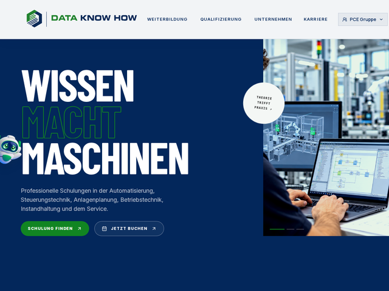

✦ ENGINEERING × IMAGINATION ✦

# Hey, I'm Shiv. 👋

### I build for the web, the factory floor & the future.

**Full-Stack Developer** &nbsp;·&nbsp; **Industrial Automation** &nbsp;·&nbsp; **Robotics**

Based in Germany 🇩🇪 &nbsp; | &nbsp; Building at [PCE Process Control Engineers GmbH](https://github.com/PCE-Process-Control-Engineers-GmbH)

 

 

✧ create with curiosity · engineer with purpose ✧

---

  

---

## 🌿 The developer behind the code

I develop **production-facing websites and web applications** for engineering businesses, while also building software for **industrial automation** and **robotics**. I enjoy turning complex technical workflows into accessible, reliable user experiences.

- **Web:** Next.js, React, TypeScript, Tailwind CSS, localized interfaces, APIs and database-connected platforms.
- **Automation:** PLC/DCS programming, HMI/SCADA systems, process control and building automation.
- **Robotics:** ROS 2, Unitree Go2 EDU, camera and LiDAR streaming, teleoperation, KISS-ICP and RTAB-Map.
- **Off-screen:** Anime, manga, music and books. 📖

> **Currently focused on:** Web platforms and developer experience for industrial engineering.

## 🍵 Selected work · the three websites

Built as part of my work with [PCE Process Control Engineers GmbH](https://github.com/PCE-Process-Control-Engineers-GmbH). Screenshots are captured from the real public websites by a scheduled GitHub Action. Some source repositories are private.

<table>
<tr>
<td width="33%" valign="top" align="center">

**01 · [PCE Controls Engineers](https://www.pce-ei.de/)**

Multilingual engineering website · DE/EN services, projects, careers and news.

<code>Next.js</code> <code>TypeScript</code> <code>next-intl</code>

[Live site ↗](https://www.pce-ei.de/)

</td>
<td width="33%" valign="top" align="center">

**02 · [PCE Energy Solutions](https://www.pce-es.de/de/)**

Responsive company website showcasing energy and engineering services.

<code>Next.js</code> <code>React</code> <code>Responsive UI</code>

[Live site ↗](https://www.pce-es.de/de/)

</td>
<td width="33%" valign="top" align="center">

**03 · [Data-Know-How](https://data-know-how.de/)**

Industrial training catalogue, qualification paths and inquiry workflows.

<code>Next.js</code> <code>Supabase</code> <code>PostgreSQL</code>

[Live site ↗](https://data-know-how.de/)

</td>
</tr>
</table>

## 🛠 Beyond the browser

| Field | What I build |
| :-- | :-- |
| 🤖 **Robotics** | Unitree Go2 EDU integrations: ROS 2, Hesai XT16 LiDAR, RealSense D435, sensor dashboard, teleoperation, 3D mapping with KISS-ICP + RTAB-Map |
| ⚙️ **Industrial systems** | PLC/DCS logic, SCADA/HMI interfaces and industrial control workflows |
| 🧩 **Internal software** | Engineering-oriented project management, resource planning and operational workflows |

### My toolkit

## 🌱 GitHub stats

<!-- Third-party cards reflect publicly available personal GitHub data; private organization work may not be included. -->

 

Public GitHub statistics do not represent all work completed in private company repositories.

## 🐍 The contribution trail

**A little pixel adventure through my contribution history.** 🎮

## ☕ Beyond the keyboard

`anime watcher` · `manga reader` · `music on repeat` · `always learning`

*Every good story has another chapter.* 🍃

---

✦ Built with curiosity, engineering, and a little everyday magic ✦

