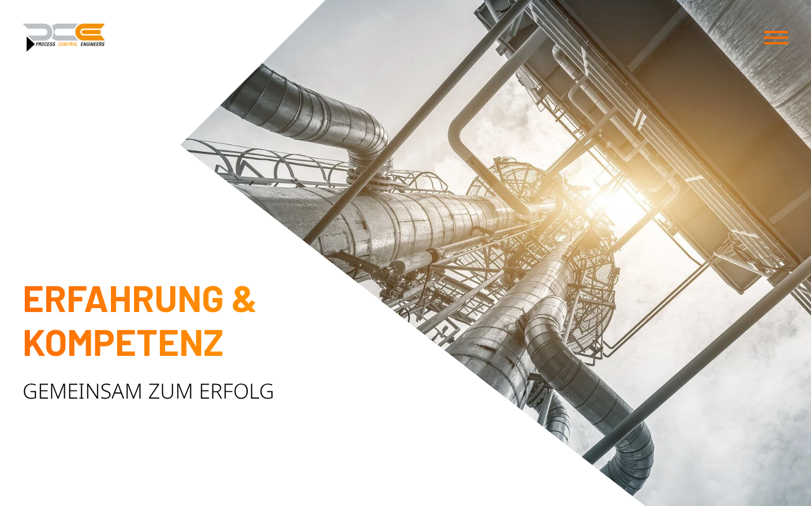
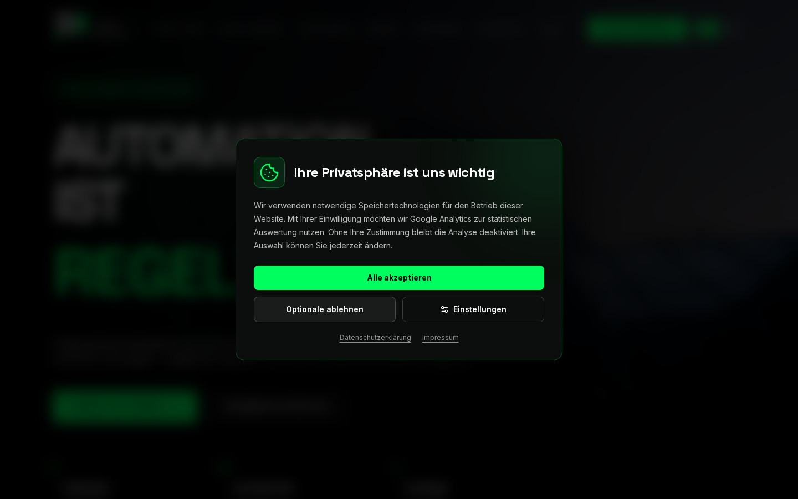
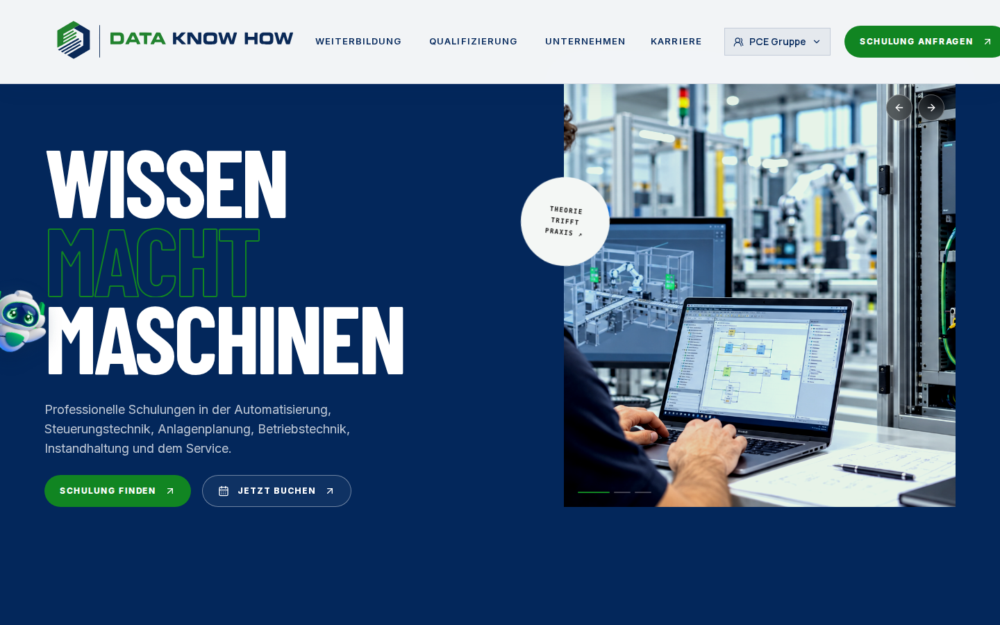

### 🍃 SHIVANSHU / SHIV 🍃

# A little code, a lot of curiosity.

**Full-Stack Developer · Industrial Automation Programmer · Robotics Enthusiast**

Germany 🇩🇪 · [PCE Process Control Engineers GmbH](https://github.com/PCE-Process-Control-Engineers-GmbH)

「小さな一歩から」 — from small steps · building useful things with a little wonder

 

---

  
   
  ✿ a quiet coding corner · original pixel art · made for this profile ✿

---

## 🌿 The developer behind the code

I develop **production-facing websites and web applications** for engineering businesses, while also building software for **industrial automation** and **robotics**. I enjoy turning complex technical workflows into accessible, reliable user experiences.

- **Web:** Next.js, React, TypeScript, Tailwind CSS, localized interfaces, APIs and database-connected platforms.
- **Automation:** PLC/DCS programming, HMI/SCADA systems, process control and building automation.
- **Robotics:** ROS 2, Unitree Go2 EDU, camera and LiDAR streaming, teleoperation, KISS-ICP and RTAB-Map.
- **Off-screen:** Anime, manga, music and books. 📖

> **Currently focused on:** Web platforms and developer experience for industrial engineering.

## 🍵 Selected work · the three websites

Built as part of my work with [PCE Process Control Engineers GmbH](https://github.com/PCE-Process-Control-Engineers-GmbH). Screenshots are captured from the real public websites by a scheduled GitHub Action. Some source repositories are private.

<table>
<tr><td width="50%" valign="top">

### 01 · PCE Controls Engineers
**Engineering, in two languages.** A responsive DE/EN company site with services, projects, careers, news and localized routing.

`Next.js` `TypeScript` `Tailwind CSS` `next-intl`

[Live website ↗](https://www.pce-ei.de/) · [Public preview](https://github.com/PCE-Process-Control-Engineers-GmbH/pce-website-preview)

</td><td width="50%" valign="top">

### 02 · PCE Energy Solutions
**Engineering with a clean digital presence.** A responsive corporate experience for energy and engineering services.

`Next.js` `React` `Responsive UI`

[Live website ↗](https://www.pce-es.de/de/) · [Public preview](https://github.com/PCE-Process-Control-Engineers-GmbH/pce-es-website-preview)

</td></tr>
<tr><td colspan="2" valign="top">

### 03 · Data-Know-How
**Industrial training, thoughtfully organized.** A course catalogue with qualification pathways, course details, and Supabase-backed inquiry and administration workflows.

`Next.js` `TypeScript` `Tailwind CSS` `Supabase` `PostgreSQL`

[Explore the live platform ↗](https://data-know-how.de/) · **Private company source repository**

</td></tr></table>

## 🛠 Beyond the browser

| Field | What I build |
| :-- | :-- |
| 🤖 **Robotics** | Unitree Go2 EDU integrations: ROS 2, Hesai XT16 LiDAR, RealSense D435, sensor dashboard, teleoperation, 3D mapping with KISS-ICP + RTAB-Map |
| ⚙️ **Industrial systems** | PLC/DCS logic, SCADA/HMI interfaces and industrial control workflows |
| 🧩 **Internal software** | Engineering-oriented project management, resource planning and operational workflows |

### My toolkit

## 🌱 GitHub activity

<!-- The cards below reflect personal/public GitHub data, not the total work owned by the PCE organization. -->

 

 

These are personal GitHub activity visualizations, not organization-wide totals. Eligible private contributions may appear as anonymized activity when GitHub settings and commit attribution permit it.

## 🐍 The contribution trail

**A little pixel adventure through my contribution history.** 🎮

Generated automatically by GitHub Actions · soft pixel palette · refreshes daily

## ☕ Beyond the keyboard

`anime watcher` · `manga reader` · `music on repeat` · `always learning`

*Every good story has another chapter.* 🍃

---

[**LinkedIn**](https://www.linkedin.com/in/shivanshupatil/) · [**Email**](mailto:shivanshupatil123@gmail.com) · [**PCE GitHub**](https://github.com/PCE-Process-Control-Engineers-GmbH)

✦ Built with curiosity, engineering, and a little everyday magic ✦

