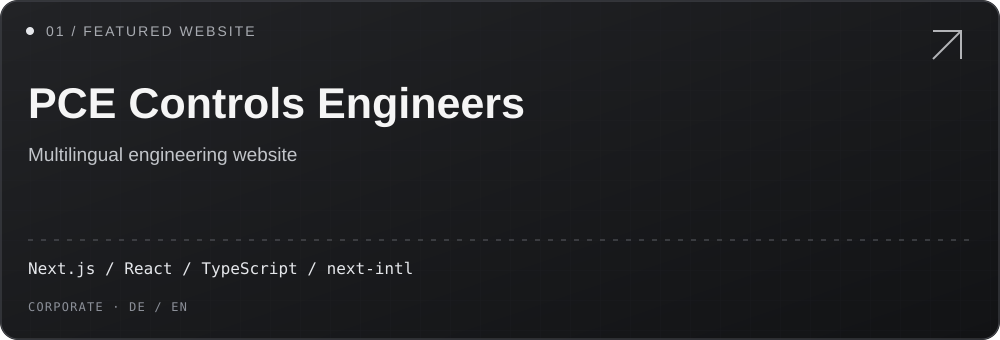
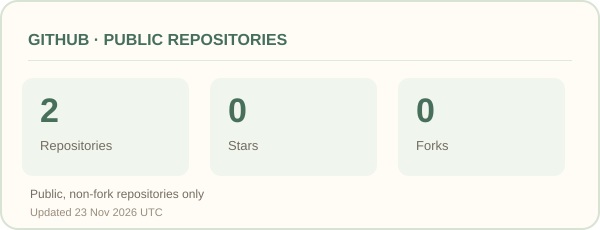

  

## Featured Websites

<table>
<tr>
<td width="50%" valign="top"></td>
<td width="50%" valign="top"></td>
</tr>
</table>

**[PCE Controls Engineers](https://www.pce-ei.de/)** — Multilingual corporate website for an engineering company, developed with Next.js, React, TypeScript, Tailwind CSS, and next-intl. German and English localization, responsive service and project pages, careers, and news.

**[PCE Energy Solutions](https://www.pce-es.de/de/)** — Corporate website for engineering and energy solutions, focused on responsive presentation and professional company communication.

**[Data-Know-How](https://data-know-how.de/)** — Full-stack industrial training platform built with Next.js, React, TypeScript, Tailwind CSS, Supabase, and PostgreSQL. Training catalogue, category and course pages, qualification pathways, database integration, and backend-connected inquiry workflows.

## About

I'm **Shiv**, a developer and industrial automation programmer based in Germany, working full-time at **PCE Process Control Engineers GmbH**. I build responsive websites, database-connected applications, and software interfaces for engineering systems.

## Engineering & Robotics

<table>
<tr>
<td width="50%" valign="top"></td>
<td width="50%" valign="top"></td>
</tr>
<tr><td colspan="2"></td></tr>
</table>

**Web development:** Next.js · React · TypeScript · JavaScript · Tailwind CSS · Python · FastAPI · Node.js · PostgreSQL · Prisma · Supabase · REST APIs · WebSockets · Figma

**Industrial automation:** PLC programming · DCS programming · SCADA · HMI · Industrial process control · Building automation

**Robotics — Unitree Go2 EDU:** ROS 2, Hesai XT16 LiDAR, Intel RealSense D435, camera streaming, live point-cloud visualization, browser-based sensor dashboards, teleoperation, KISS-ICP LiDAR odometry, RTAB-Map 3D SLAM, Three.js, Python and FastAPI.

**Tools:** Git · GitHub · Docker · Linux / Ubuntu · C++

**Outside work:** Music · Anime · Manga · Books

## GitHub Activity

<table>
<tr>
<td width="50%"></td>
<td width="50%"></td>
</tr>
</table>

Automatically refreshed daily using GitHub Actions. Counts include public, non-fork repositories only. Language counts reflect each repository’s primary language, not lines of code or proficiency.

## Technologies

## Connect

 
