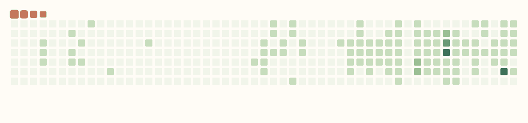

### ✦ SHIVANSHU / SHIV ✦

# Building things for the real world.

**Full-Stack Developer · Industrial Automation Programmer · Robotics Enthusiast**

Germany 🇩🇪 · [PCE Process Control Engineers GmbH](https://github.com/PCE-Process-Control-Engineers-GmbH)

「コードと創造性」 — code & creativity · an engineering portfolio with a little anime energy

 

---

## 🌸 The developer behind the code

I develop **production-facing websites and web applications** for engineering businesses, while also building software for **industrial automation** and **robotics**. I enjoy turning complex technical workflows into accessible, reliable user experiences.

- **Web:** Next.js, React, TypeScript, Tailwind CSS, localized interfaces, APIs and database-connected platforms.
- **Automation:** PLC/DCS programming, HMI/SCADA systems, process control and building automation.
- **Robotics:** ROS 2, Unitree Go2 EDU, camera and LiDAR streaming, teleoperation, KISS-ICP and RTAB-Map.
- **Off-screen:** Anime, manga, music and books. 📖

> **Currently focused on:** Web platforms and developer experience for industrial engineering.

## ✨ Featured web projects

My main work lives in the [PCE GitHub organization](https://github.com/PCE-Process-Control-Engineers-GmbH). Some source repositories are private; the public product links below are the best way to explore the work.

<table>
<tr>
<td width="50%" valign="top">

### 01 · [PCE Controls Engineers](https://www.pce-ei.de/)

**Multilingual engineering company website**

DE/EN experience with service and project pages, careers, news, responsive layouts and localized routing.

`Next.js` `TypeScript` `Tailwind CSS` `next-intl`

[**Visit live site ↗**](https://www.pce-ei.de/) · [Public preview repository](https://github.com/PCE-Process-Control-Engineers-GmbH/pce-website-preview)

</td>
<td width="50%" valign="top">

### 02 · [PCE Energy Solutions](https://www.pce-es.de/de/)

**Corporate energy and engineering website**

Responsive company presentation and polished web experience for engineering and energy solutions.

`Next.js` `React` `Responsive UI`

[**Visit live site ↗**](https://www.pce-es.de/de/) · [Public preview repository](https://github.com/PCE-Process-Control-Engineers-GmbH/pce-es-website-preview)

</td>
</tr>
<tr>
<td colspan="2" valign="top">

### 03 · [Data-Know-How](https://data-know-how.de/)

**Industrial training and inquiry platform**

Training catalogue, course details, qualification pathways, multilingual-friendly page structure, and backend-connected inquiry/admin flows. Built for people who need to find the right industrial training without friction.

`Next.js` `TypeScript` `Tailwind CSS` `Supabase` `PostgreSQL`

[**Explore platform ↗**](https://data-know-how.de/) · **Source: private company repository**

</td>
</tr>
</table>

## 🛠 Beyond the browser

| Field | What I build |
| :-- | :-- |
| 🤖 **Robotics** | Unitree Go2 EDU integrations: ROS 2, Hesai XT16 LiDAR, RealSense D435, sensor dashboard, teleoperation, 3D mapping with KISS-ICP + RTAB-Map |
| ⚙️ **Industrial systems** | PLC/DCS logic, SCADA/HMI interfaces and industrial control workflows |
| 🧩 **Internal software** | Engineering-oriented project management, resource planning and operational workflows |

### My toolkit

## 📈 GitHub activity

<!-- The cards below reflect personal/public GitHub data, not the total work owned by the PCE organization. -->

 

 

GitHub contribution activity can include eligible commits to company repositories when attributed to this account. Private repo names and code are never disclosed by these widgets.

## 🐍 Contribution quest

**The contribution grid, but make it an arcade level.** 🎮

Generated automatically by GitHub Actions · pastel pixel palette · refreshes daily

## ☕ After-hours loading screen

`anime watcher` · `manga reader` · `music on repeat` · `always learning`

*The next arc is always under development.* 🌷

---

[**LinkedIn**](https://www.linkedin.com/in/shivanshupatil/) · [**Email**](mailto:shivanshupatil123@gmail.com) · [**PCE GitHub**](https://github.com/PCE-Process-Control-Engineers-GmbH)

✦ Built with curiosity, engineering, and a few anime references ✦

